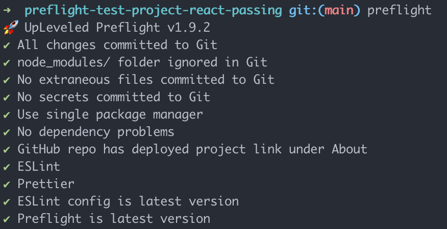

# UpLeveled Preflight

A command line tool to check your UpLeveled projects before you submit



## Install

```bash
pnpm add --global @upleveled/preflight
```

## Run

```bash
preflight
```

## Install and Run with Docker

```bash
# Pull the image
docker pull ghcr.io/upleveled/preflight

# Run the image against a GitHub repo URL
docker run ghcr.io/upleveled/preflight https://github.com/upleveled/preflight-test-project-react-passing

# Or run the image against a specific branch in a GitHub repo URL
docker run ghcr.io/upleveled/preflight https://github.com/upleveled/preflight-test-project-react-passing fix-tests
```

The Docker image generates Next.js types with `pnpm next typegen` for projects
with a `next` dependency before setting up PostgreSQL and running Preflight.
The image checks `pnpm next --help` for command support and skips type generation
on Next.js versions before 15.5, which do not include `next typegen`.
This generates `PageProps` and typed routes needed by ESLint in a fresh clone,
without building the app. See the [Next.js type generation documentation](https://nextjs.org/docs/app/api-reference/cli/next#next-typegen-options).

When running Preflight locally in a Next.js 15.5 or later project, generate these types first:

```bash
pnpm next typegen
preflight
```

## Run Preflight with GitHub Actions workflow

To run Preflight on every commit in your repository, you can use the following GitHub Actions workflow:

`.github/workflows/preflight.yml`

```yaml
name: Preflight
on: [push]

jobs:
  preflight:
    name: Preflight
    runs-on: ubuntu-latest

    steps:
      - name: Pull latest Preflight image
        run: docker pull ghcr.io/upleveled/preflight
      - name: Run Preflight
        run: docker run ghcr.io/upleveled/preflight https://github.com/${{ github.repository}} ${{ github.ref_name }}
```
